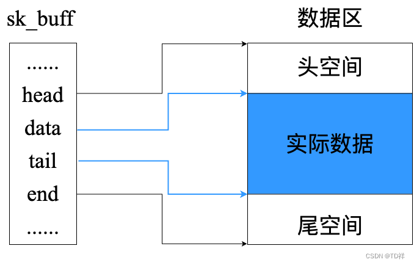

# 套接字缓存 skbuff
在 Netfile 之中我们要读取数据包的数据或者状态，就需要通过 `struct sk_buff` 这个结构体来完成  
该结构包含在路径 `/usr/src/linux-headers-$(uname -r)/include/linux/skbuff.h` 当中

## 基本结构
sk_buff 中包含线性数据和非线性数据，这里我们只需要知道线性数据就是我们保存数据包实际内容的地方即可，其基本结构如下：  
  

其中**头空间 headroom 和尾空间 tailroom 都是用来进行扩展或封装数据的预留空间**  

sk_buff 中有四个非常重要的“指针”，用来指示线性数据的区域：  
* **head**: 实际上是一个 `unsigned char *`，指示线性数据的起始位置  
* **data**: 实际上是一个 `unsigned char *`，指示实际数据的起始位置，在 netfilter 的钩子函数中，通常这个指针指向的是网络层头部的位置  
* **tail**: 实际上是一个数，指向数据包实际数据之后的字节，也是尾空间的起始位置与 head 指向位置的偏移字节数  
* **end**: 实际上是一个数，指向尾空间之后的字节，也是非线性数据的起始与 head 指向位置的偏移字节数  

## skb 操作
skb 中线性数据的操作通常是看作栈来进行的，主要涉及以下几个函数：  
``` C
#include <linux/skbuff.h>
unsigned char *skb_pull(struct sk_buff *skb, unsigned int len);
unsigned char *skb_push(struct sk_buff *skb, unsigned int len);
unsigned char *skb_put(struct sk_buff *skb, unsigned int len);
```

`skb_pull()` 可以将报文头部解封装，**它的本质是移动 `data` 指针缩小实际数据空间，并修改 `len`（注意数据实际上并没有被删除）**，返回值为 `data` 指向的更新的位置  

`skb_push()` 可以用来封装报文头，**它的本质是移动 `data` 指针扩大实际数据空间，并修改 `len`（注意数据并没有被放置到 skb 当中**，返回值为 `data` 指向的更新的位置  
为了将数据放进 skb 的实际数据区，还需要调用其它的函数将数据复制进去，如 `strncpy`  

`skb_put()` 可以用来向尾部添加数据，**它的本质是移动 `tail` 指针扩大实际数据空间，并修改 `len`（注意数据并没有被放置到 skb 当中**  

在 skb_push() 和 skb_pull() 之中都会进行长度的判断，尤其是 push 时，如果移动后的 `data` 指针超过了头空间预留的大小，那么内核就会报错。  

为了扩大头空间和尾空间，我们可以使用以下函数：  
``` C
#include <linux/skbuff.h>
int pskb_expand_head(struct sk_buff *skb, int nhead, int ntail, gfp_t gfp_mask);
```
其中 `gfp_mask` 使用 `GFP_ATOMIC` 作为实参即可  

-------------------
## skb 协议头部
skb 在接受和发送数据的时候都会设置一系列“指针”指向不同层次的协议头部，他们的定义主要如下：  
``` C
struct sk_buff {
    __u16 transport_header; // 传输层头部
    __u16 network_header;   // 网络层头部
    __u16 mac_header;       // MAC 头
}
```
由于他们是一个 2 字节的无符号数，所以**实际上表示的是各头部距离 `head` 指向位置的字节数**  
但是当通过内联函数获取时可以直接访问头部的地址：  
``` C
// 以下函数一律返回 head + header
static inline unsigned char *skb_network_header(const struct sk_buff *skb);
static inline unsigned char *skb_transport_header(const struct sk_buff *skb);
static inline unsigned char *skb_mac_header(const struct sk_buff *skb);
```

如果在修改数据包的时候头部位置发生变化，那么这些“指针”也需要一并修改，涉及到以下函数：  
``` C
// reset 的功能一律都是将 header 设置为 data - head
static inline void skb_reset_network_header(struct sk_buff *skb);
static inline void skb_reset_transport_header(struct sk_buff *skb);
static inline void skb_reset_mac_header(struct sk_buff *skb);

// set 的功能一律都是先 reset 然后将 header 增加 offset 个单位（距离 data 指示的位置 offset 个字节）
static inline void skb_set_network_header(struct sk_buff *skb, const int offset);
static inline void skb_set_transport_header(struct sk_buff *skb, const int offset);
static inline void skb_set_mac_header(struct sk_buff *skb, const int offset);
```

-------------------------
## 校验和
传输层校验和需要检验：伪头部 + 传输层头部 + 传输层负载  
其中伪头部包括目的和源 IP 地址、传输层数据的长度、传输层使用的协议  
`skb->csum` 表示的是传输层 payload 的 checksum（不包括伪头部），`skb->is_summed` 表示的是传输层的校验和状态，有以下取值：  
``` C
#define CHECKSUM_NONE 0
#define CHECKSUM_UNNECESSARY 1
#define CHECKSUM_COMPLETE 2
```

* 对于发送方来说：（硬件还需要做什么）  
  CHECKSUM_NONE 表示L4校验已经由软件实现，硬件无需做任何事情  
  CHECKSUM_PARTIAL 表示软件已经计算了伪报头的校验和并置于传输层头部的check字段，硬件需要做剩下的工作  
* 对于接收方来说：（软件还需要做什么）  
  CHECKSUM_NONE 表示 skb->csum 字段无效，需要软件重新计算  
  CHECKSUM_COMPLETE 表示硬件已经完成了传输层报头和其载荷部分的校验，且校验和保存在 skb->csum 中，软件只需计算伪报头即可  
  CHECKSUM_UNNECESSARY 表示硬件已经进行了完整的校验，软件无需再进行检查  

------------
目前这些知识够用了，待补充  